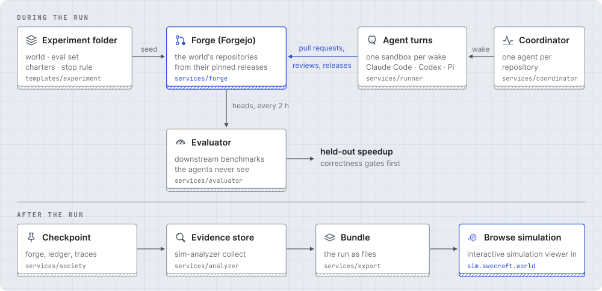

# World of SWECraft: `launcher`

The code behind [World of SWECraft: Agent Collaboration at Scale via Simulated
Software Worlds](https://arxiv.org/abs/2610.24061)
([project page](https://szj.io/sw)).


A seeded Forgejo forge holds the world's repositories at pinned releases. A
coordinator wakes one maintainer agent per repository on a cadence, and each
wake is a sandboxed agent turn in which the agent works on the forge directly
(branches, pull requests, reviews, merges, releases) under its own identity.
An evaluator measures the released code with the benchmarks of downstream
projects the agents never see. At the end, one checkpoint captures the whole
experiment, and an export turns it into a bundle you can browse in
sim-browser.

## How a run works

<picture>
  <source media="(prefers-color-scheme: dark)" srcset="docs/assets/run-flow-dark.svg">
  
</picture>

## Components

| Path | What it is |
| --- | --- |
| `services/forge` | Local Forgejo with an Actions runner |
| `services/world` | World manifest, seeder and lock |
| `services/index-cap` | PyPI's index as it stood on the world's date |
| `services/coordinator` | The wake loop: one maintainer agent per repository |
| `services/runner`, `services/runner-image` | One sandboxed agent turn through Harbor (Claude Code, Codex, Pi), and its task image |
| `services/evaluator` | Downstream evaluation: the dependents' own benchmarks, gated |
| `services/society` | Checkpoint, load, resume and publish an experiment |
| `services/analyzer` | A checkpoint as a queryable evidence store |
| `services/export` | A checkpoint as a sim-browser bundle |
| `packages/swecraft-common` | Shared git, Forgejo and run-id code |
| `packages/swecraft-launch` | The launcher: `swecraft-launch <step> <folder>` |
| `templates/experiment` | The experiment folder to copy |

## Start here

```bash
uv sync --all-packages --all-groups && source .venv/bin/activate
just quick-start                                # one agent on a demo repository
```

A full experiment, from an empty host to a browsable export:

```bash
cp -r templates/experiment experiments/<name>   # fill every FILL marker
swecraft-launch check    experiments/<name>
swecraft-launch up       experiments/<name>     # capped index + forge
swecraft-launch seed     experiments/<name>     # world at its pins, CI enabled
swecraft-launch shakeout experiments/<name>     # A/A run: every gate must pass
swecraft-launch onboard  experiments/<name>     # agents' identities + bootstrap
swecraft-launch run      experiments/<name>     # until the stop rule, then finish
swecraft-launch export   experiments/<name>     # bundles/<name> for sim-browser
```

`just exp <step> experiments/<name>` runs the same through uv without
activating the environment. [Run an experiment](docs/tutorials/run-an-experiment.md)
walks through each step and the decisions behind it; the
[docs index](docs/README.md) maps every component to its reference page.

## Results in the paper


Held-out speedup grows with the tokens agents spend, with large differences
between models, in all three worlds of the paper: World-1 (networking), World-2
(data science) and World-3 (web and tooling).

## Development

```bash
just python-lock-check
just python-check
just python-test
```

## Citation

```bibtex
@article{shen2026swecraft,
  title   = {World of SWECraft: Agent Collaboration at Scale via Simulated Software Worlds},
  author  = {Shen, Shannon Zejiang and Chang, Yapei and Liang, Qiyao and Newman, Benjamin and
             Liang, Jenny and Shao, Rulin and Ma, Ziqiao and Yin, Junjie Oscar and
             Chuang, Yung-Sung and Shi, Weijia and Choi, Yejin and Zettlemoyer, Luke and
             Koh, Pang Wei and Iyyer, Mohit and Wu, Tongshuang and Sontag, David},
  journal = {arXiv preprint arXiv:2610.24061},
  year    = {2026}
}
```

## License

MIT; see [LICENSE](LICENSE).
